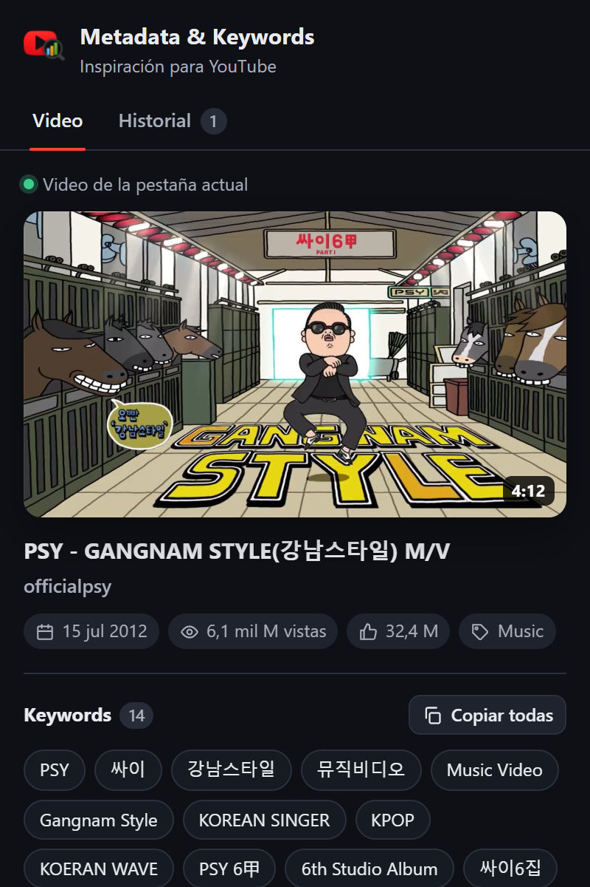
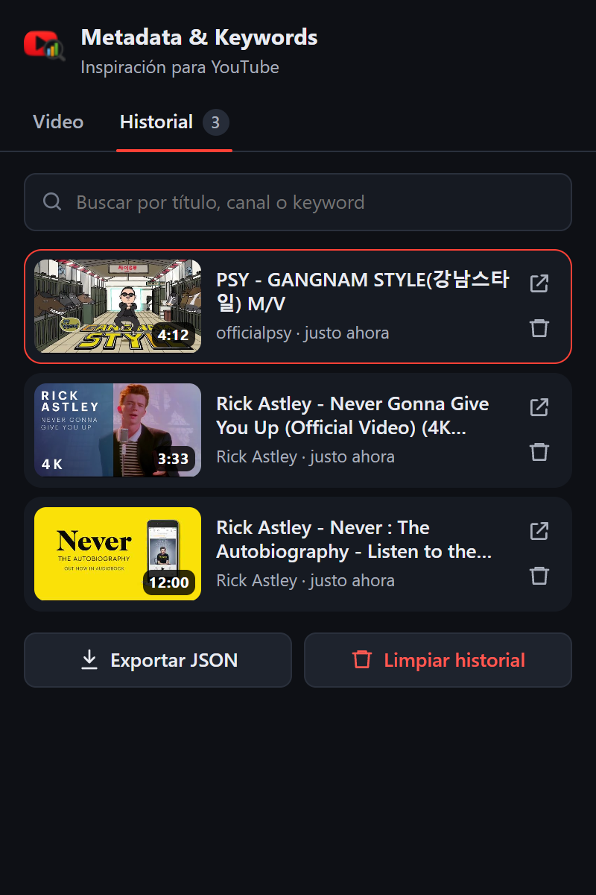

# 🎯 Metadata & Keywords Analyzer para YouTube

Extensión para navegadores Chromium (Chrome, Edge, Brave, Opera…) pensada para creadores de contenido que estudian videos de referencia: captura automáticamente **miniatura, título, canal, keywords, descripción y estadísticas** de cada video que abres y los guarda en un **historial de inspiración** local.

  

<p align="center">
  
  &nbsp;&nbsp;
  
</p>

---

## Índice

- [Funcionalidades](#-funcionalidades)
- [Instalación](#-instalación)
- [Uso](#-uso)
- [Cómo funciona](#-cómo-funciona)
- [Datos capturados](#-datos-capturados)
- [Permisos](#-permisos)
- [Privacidad](#-privacidad)
- [Desarrollo](#-desarrollo)
- [Limitaciones conocidas](#-limitaciones-conocidas)
- [Changelog](#-changelog)
- [Contribuir](#-contribuir)
- [Disclaimer](#️-disclaimer)

---

## ✨ Funcionalidades

**Panel del video**

- Miniatura en la mejor resolución disponible (MaxRes → SD → HQ) con **descarga en un clic**.
- Título y canal enlazados a YouTube, fecha de publicación, vistas, likes, categoría y duración.
- **Keywords (tags) completas** del video: copia todas a la vez o haz clic en una para copiarla sola.
- **Copiar ficha completa**: título, canal, URL, fecha, duración, vistas, likes y keywords en texto plano, lista para pegar en tus notas.
- Descripción completa y metadata técnica (JSON) en secciones desplegables, con copia y descarga `.json`.
- Indica si estás viendo el video de la pestaña actual, uno del historial o el último capturado.

**Historial de inspiración**

- Cada video que abres se guarda automáticamente (incluye Shorts y navegación dentro de YouTube).
- Ordenado por última visita; revisitar un video lo sube al principio y actualiza sus datos.
- **Búsqueda** por título, canal o keyword (ignora mayúsculas y tildes).
- Eliminar videos individuales con opción de **Deshacer**.
- **Exportar** todo el historial a JSON y limpiarlo (con confirmación).

**General**

- Tema claro / oscuro automático según el sistema.
- Accesible por teclado (pestañas con flechas, foco visible, etiquetas ARIA).
- Todo se guarda localmente en `chrome.storage.local` (máximo 300 videos; los más antiguos se descartan).

---

## 🖥 Instalación

1. Clona o descarga el repositorio:

   ```bash
   git clone https://github.com/santy10e/YoutubeData_Extension.git
   ```

2. Abre la página de extensiones de tu navegador: `chrome://extensions` (en Edge: `edge://extensions`).
3. Activa el **Modo desarrollador**.
4. Pulsa **Cargar descomprimida** y selecciona la carpeta del proyecto.
5. Fija la extensión en la barra para tenerla a mano.

> Si ya tenías pestañas de YouTube abiertas antes de instalarla no hace falta recargarlas: al abrir el popup sobre un video, la extensión lo captura en ese momento.

---

## 🚀 Uso

1. Abre cualquier video de YouTube (`/watch`, `/shorts`, `/live`).
2. Haz clic en el icono de la extensión:
   - Pestaña **Video**: análisis del video actual y acciones rápidas de copia y descarga.
   - Pestaña **Historial**: todos los videos capturados; haz clic en uno para verlo en el panel.
3. Sigue navegando: cada video nuevo se agrega solo al historial.

---

## 🧩 Cómo funciona

```
YouTube (pestaña)                     Service worker                  Popup
┌──────────────────────┐  VIDEO_METADATA  ┌───────────────────┐  storage.onChanged  ┌───────────┐
│ content.js           │ ───────────────▶ │ background.js     │ ──────────────────▶ │ popup.js  │
│ detecta el video y   │                  │ único escritor,   │                     │ renderiza │
│ extrae la metadata   │ ◀─────────────── │ cola serializada  │ ◀────────────────── │ y acciones│
└──────────────────────┘   CAPTURE_NOW    └───────────────────┘  DELETE / RESTORE / └───────────┘
                           (desde el popup)        │               CLEAR_HISTORY
                                                   ▼
                                         chrome.storage.local
```

1. **`content.js`** detecta el video abierto. YouTube es una SPA, así que escucha el evento `yt-navigate-finish`, `popstate` y, como red de seguridad, comprueba la URL cada segundo.
2. La metadata se obtiene de `ytInitialPlayerResponse`, la misma estructura que usa el reproductor de YouTube:
   - en la carga inicial, del HTML de la página;
   - al navegar dentro de YouTube, descargando la página `/watch` del video (el HTML inicial, el JSON-LD y `<meta name="keywords">` **no se actualizan** en la navegación SPA);
   - si todo falla, del DOM ya renderizado (sin keywords).

   Siempre se comprueba que los datos correspondan al `videoId` actual, para no mezclar información de videos distintos.
3. **`background.js`** es el único que escribe en el almacenamiento: inserta o actualiza el video en una cola serializada, evitando condiciones de carrera con varias pestañas abiertas.
4. **`popup.js`** lee el historial, escucha `chrome.storage.onChanged` y se actualiza en vivo. Si la pestaña activa es un video aún no capturado, pide la captura (`CAPTURE_NOW`) o inyecta el content script.

### Estructura del proyecto

```
├── manifest.json        Configuración de la extensión (MV3)
├── utils.js             Lógica pura compartida: parser, modelo, formato, historial
├── content.js           Detección de videos y extracción de metadata
├── background.js        Service worker: persistencia del historial
├── popup.html/css/js    Interfaz del popup
├── icons/               Iconos de la extensión
├── img/                 Capturas para este README
└── tests/               Tests unitarios (node:test)
```

---

## 📦 Datos capturados

Cada video se guarda con esta forma (ejemplo abreviado):

```json
{
  "videoId": "dQw4w9WgXcQ",
  "url": "https://www.youtube.com/watch?v=dQw4w9WgXcQ",
  "title": "Rick Astley - Never Gonna Give You Up (Official Video) (4K Remaster)",
  "description": "The official video for “Never Gonna Give You Up”…",
  "uploadDate": "2009-10-24T23:57:33-07:00",
  "duration": "PT3M33S",
  "lengthSeconds": 213,
  "viewCount": 1834537675,
  "likeCount": 19494216,
  "isLive": false,
  "category": "Music",
  "channel": { "name": "Rick Astley", "id": "UCuAXFkgsw1L7xaCfnd5JJOw", "url": "https://www.youtube.com/@RickAstleyYT" },
  "thumbnails": { "maxres": "…/maxresdefault.jpg", "sd": "…/sddefault.jpg", "hq": "…/hqdefault.jpg", "best": "…" },
  "keywords": ["rick astley", "Never Gonna Give You Up", "…"],
  "source": "playerResponse",
  "capturedAt": 1762470000000,
  "lastSeenAt": 1762470000000
}
```

`source` indica de dónde salieron los datos (`playerResponse` o `dom`). `capturedAt` es la primera visita y `lastSeenAt` la más reciente. El historial guardado por la versión 1.0 sigue siendo compatible.

---

## 🔑 Permisos

| Permiso | Para qué se usa |
| --- | --- |
| `storage` | Guardar el historial localmente en el navegador. |
| `downloads` | Descargar la miniatura en máxima resolución. |
| `scripting` | Capturar videos en pestañas abiertas antes de instalar o recargar la extensión. |
| `https://www.youtube.com/*` | Leer la metadata del video que estás viendo. |

---

## 🔐 Privacidad

- No recolecta información personal ni usa cookies propias, analítica o tracking.
- No envía datos a servidores de terceros. Las únicas peticiones de red son a YouTube: la página del video que estás viendo (al navegar dentro del sitio) y sus miniaturas (`i.ytimg.com`).
- Todo el historial vive en tu navegador; puedes exportarlo o borrarlo cuando quieras.

---

## 🛠 Desarrollo

No hay dependencias ni paso de build: edita los archivos y recarga la extensión desde `chrome://extensions`.

Los tests unitarios cubren el parser, el modelo de datos, el historial y el formato. Requieren Node.js 18 o superior:

```bash
node --test tests/utils.test.js
```

Para depurar:

- **Content script**: DevTools de la pestaña de YouTube → consola (mensajes con prefijo `[YT Metadata]`).
- **Service worker**: `chrome://extensions` → *Inspeccionar vistas: service worker*.
- **Popup**: clic derecho sobre el popup → *Inspeccionar*.

---

## 🧪 Limitaciones conocidas

- YouTube puede cambiar su estructura interna sin aviso; si `ytInitialPlayerResponse` deja de estar disponible, la extensión recurre al DOM y en ese caso **no obtiene keywords**.
- Las keywords son las que el creador declaró como tags públicos; muchos videos no tienen ninguna.
- El título guardado es el original del video, aunque YouTube te lo muestre traducido automáticamente.
- Solo funciona en `www.youtube.com` (no en `m.youtube.com` ni YouTube Music).

---

## 📝 Changelog

### 1.1.0

**Correcciones**

- Al navegar entre videos sin recargar, se guardaban la miniatura, las keywords y la fecha **de otro video** (JSON-LD y `<meta>` obsoletos en la SPA). Ahora la metadata se lee de `ytInitialPlayerResponse` y se valida contra el `videoId`.
- El título o el canal podían guardarse vacíos si el DOM aún no había cargado, sin reintentar nunca.
- Posible inyección de HTML en el popup a través de títulos y keywords (`innerHTML`); ahora todo se renderiza como texto.
- Errores `Receiving end does not exist` en consola cuando el popup estaba cerrado.
- Al limpiar el historial, el panel seguía mostrando el último video.
- Los toasts se cortaban si se mostraban dos seguidos.
- La miniatura MaxRes aparecía como un placeholder gris en videos sin esa resolución.
- Un `MutationObserver` sobre todo el `body` se ejecutaba en cada cambio del DOM (impacto en rendimiento).
- Clave inválida `matches` en el manifest y permisos innecesarios (`tabs`, `activeTab`).
- Fechas mostradas en formato ISO crudo.

**Mejoras**

- Interfaz rediseñada: pestañas Video / Historial, estados vacío y de carga, tema claro/oscuro, accesibilidad.
- Estadísticas (vistas, likes, duración, categoría), soporte de Shorts y directos.
- Copia individual de keywords, ficha completa y descripción; descarga de miniatura y JSON.
- Historial con búsqueda, borrado individual con deshacer, exportación y límite de 300 videos.
- Captura bajo demanda en pestañas abiertas antes de instalar la extensión.
- Tests unitarios.

### 1.0

- Versión inicial.

---

## 🤝 Contribuir

Las contribuciones son bienvenidas: mejoras de UI/UX, robustez del parser, nuevas métricas o reportes de bugs.

1. Haz un fork y crea una rama (`git checkout -b mejora/mi-cambio`).
2. Asegúrate de que los tests pasan (`node --test tests/utils.test.js`).
3. Abre un Pull Request describiendo el cambio y cómo probarlo.

---

## ⚠️ Disclaimer

Este proyecto **no está afiliado a YouTube ni a Google**. Está pensado para análisis creativo, benchmarking e investigación de inspiración visual. Es responsabilidad de cada usuario cumplir los términos de uso de la plataforma.
